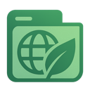
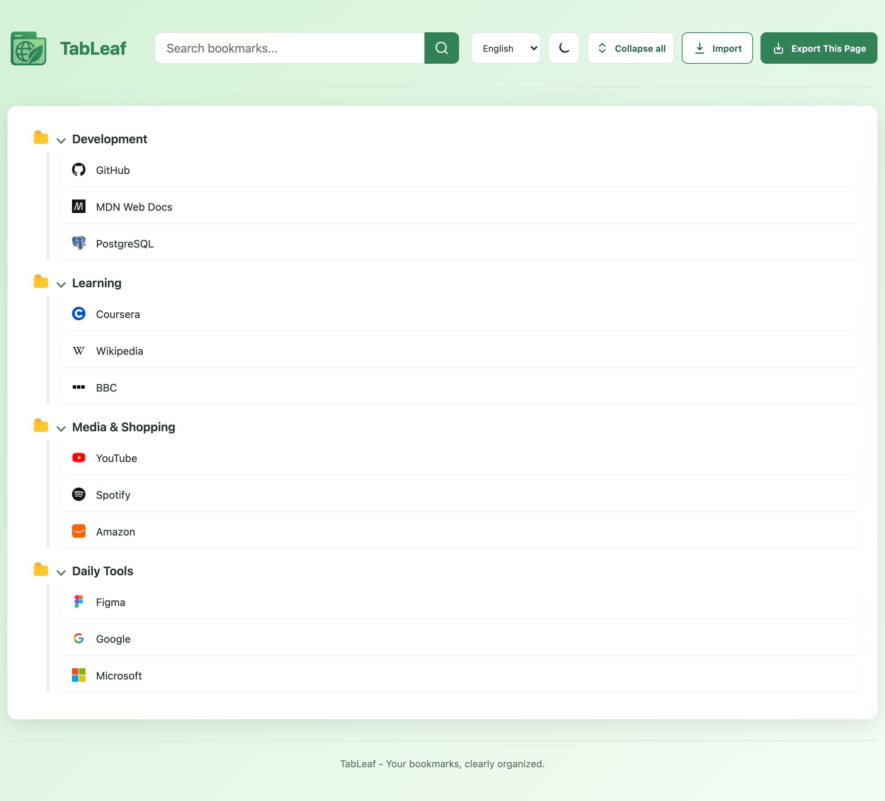
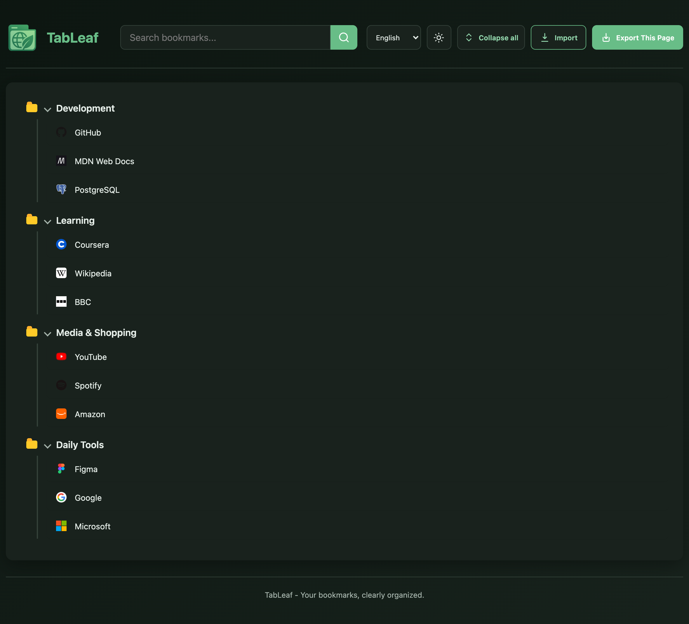

<p align="center">
  
</p>

# TabLeaf

<p align="center">
  <a href="https://microsoftedge.microsoft.com/addons/detail/tableaf/">
    
  </a>
  <a href="https://chromewebstore.google.com/detail/tableaf/epkmlnmdkemfgoichlcofhpnadgcpldk"></a>
  <a href="https://addons.mozilla.org/zh-CN/firefox/addon/tableaf/">
    
  </a>
</p>

用于浏览、搜索、导入和导出浏览器书签备份的 Manifest V3 扩展。

## 预览

<table align="center">
  <tr>
    <td></td>
    <td></td>
  </tr>
</table>

## 功能

- 以文件夹树展示书签，可实时搜索标题和 URL
- 一键导出为可离线打开、支持搜索的书签HTML页面
- 支持浅色、深色模式和页面内语言切换


## 语言

支持英语、简体中文、繁体中文、日语、韩语、德语、法语、西班牙语和俄语。默认跟随浏览器语言，也可通过页面中的语言选择器手动切换并记住选择。

## 打包

```sh
npm run package
```

脚本会生成两个只包含运行文件的发布包：

- `dist/tableaf-<版本>.zip`：Chrome、Edge 等 Chromium 浏览器
- `dist/tableaf-firefox-<版本>.zip`：Firefox

可加 `-- --skip-tests` 跳过测试。

## 测试

```sh
npm test
```

## 目录

- `extension/app.js`：页面状态和交互
- `extension/lib/bookmarks.js`：数据规范化、URL 校验和搜索
- `extension/lib/import.js`：HTML / JSON 导入
- `extension/lib/storage.js`：备份存储
- `extension/lib/render.js`：书签树渲染
- `extension/lib/export.js`：HTML 导出
- `extension/lib/request-tracker.js`：异步加载竞态保护
- `extension/lib/i18n.js`：界面本地化
- `extension/_locales/`：各语言文案
- `extension/manifest.firefox.json`：Firefox 独立清单
- `scripts/package.sh`：发布包生成脚本

## 权限

- `bookmarks`：读取书签
- `favicon`：获取本地 favicon
- `storage`：保存导入备份
- `unlimitedStorage`：避免大书签备份触及默认存储配额

## 数据与隐私

- 书签数据只在本地浏览器中处理。
- favicon 优先来自浏览器本地缓存；缺失时仅向书签原站请求。
- 导入备份保存在扩展本地存储中，不会自动上传。

## 浏览器支持

支持 Microsoft Edge、Chrome 等 Chromium 浏览器，以及 Firefox。Chromium
使用 `extension/manifest.json` 和 `background.service_worker`；Firefox 构建使用
`extension/manifest.firefox.json` 和兼容的事件页脚本。Safari 仍需使用 Apple Web
Extension Converter 转换后单独测试。

