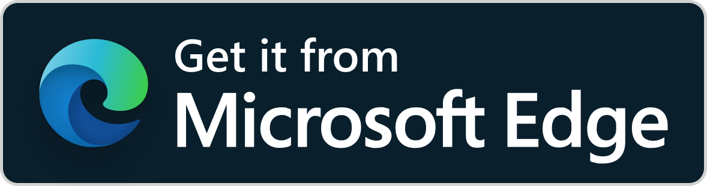
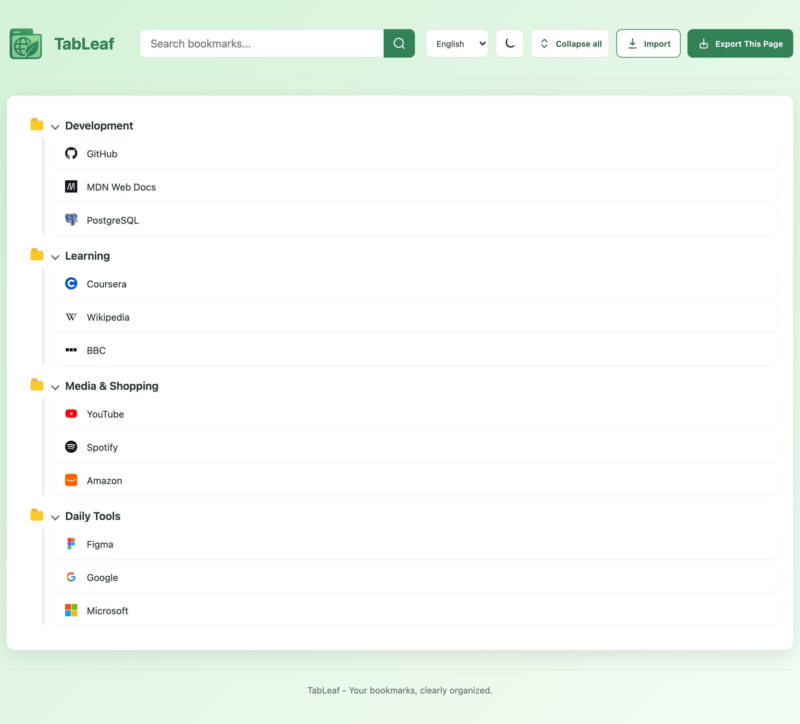
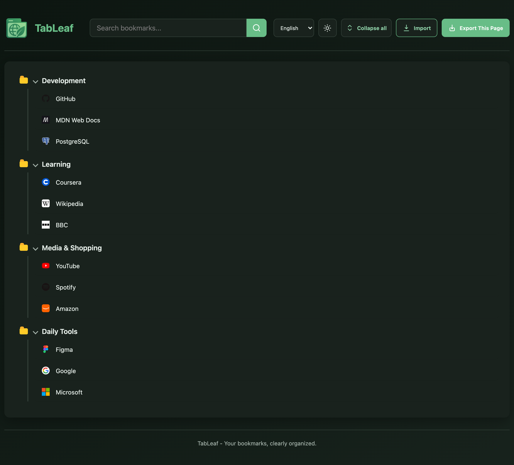

<p align="center">
  
</p>

# TabLeaf

<p align="center">
  <a href="https://microsoftedge.microsoft.com/addons/detail/tableaf/ddgmhnlbnbgjjccafnfjfknbadpdknle">
    
  </a>
  <a href="https://chromewebstore.google.com/detail/tableaf/epkmlnmdkemfgoichlcofhpnadgcpldk"></a>
  <a href="https://addons.mozilla.org/zh-CN/firefox/addon/tableaf/">
    
  </a>
</p>

A Manifest V3 extension for browsing, searching, importing, and exporting browser bookmark backups.

## Preview

<table align="center">
  <tr>
    <td></td>
    <td></td>
  </tr>
</table>

## Features

- Display bookmarks as a folder tree with real-time title and URL search
- Export a searchable HTML bookmark page that can be opened offline with one click
- Support light and dark modes and in-page language switching


## Languages

Supports English, Simplified Chinese, Traditional Chinese, Japanese, Korean, German, French, Spanish, and Russian. It follows the browser language by default, and you can also switch languages manually with the language selector on the page and have your choice remembered.

## Packaging

```sh
npm run package
```

The script generates two release packages containing only runtime files:

- `dist/tableaf-<version>.zip`: Chromium browsers such as Chrome and Edge
- `dist/tableaf-firefox-<version>.zip`: Firefox

Add `-- --skip-tests` to skip the tests.

## Testing

```sh
npm test
```

## Directory

- `extension/app.js`: Page state and interactions
- `extension/lib/bookmarks.js`: Data normalization, URL validation, and search
- `extension/lib/import.js`: HTML / JSON import
- `extension/lib/storage.js`: Backup storage
- `extension/lib/render.js`: Bookmark tree rendering
- `extension/lib/export.js`: HTML export
- `extension/lib/request-tracker.js`: Async loading race protection
- `extension/lib/i18n.js`: UI localization
- `extension/_locales/`: Localized messages
- `extension/manifest.firefox.json`: Firefox-specific manifest
- `scripts/package.sh`: Release package generation script

## Permissions

- `bookmarks`: Read bookmarks
- `favicon`: Retrieve local favicons
- `storage`: Save imported backups
- `unlimitedStorage`: Avoid reaching the default storage quota with large bookmark backups

## Data & Privacy

- Bookmark data is processed only in the local browser.
- Favicons are preferably retrieved from the browser's local cache; when unavailable, they are requested only from the bookmark's original site.
- Imported backups are saved in the extension's local storage and are never uploaded automatically.

## Browser Support

Supports Chromium browsers such as Microsoft Edge and Chrome, as well as Firefox. Chromium
uses `extension/manifest.json` and `background.service_worker`; Firefox builds use
`extension/manifest.firefox.json` and a compatible event page script. Safari still requires conversion with
Apple Web Extension Converter and separate testing.

